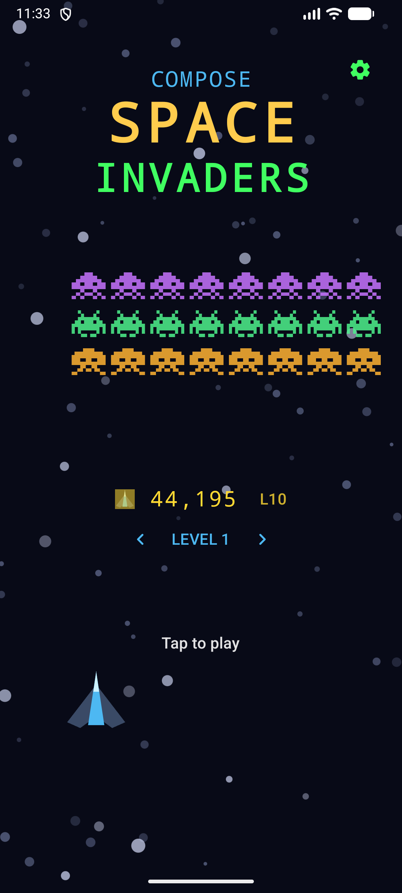
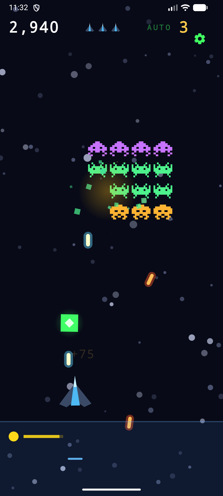
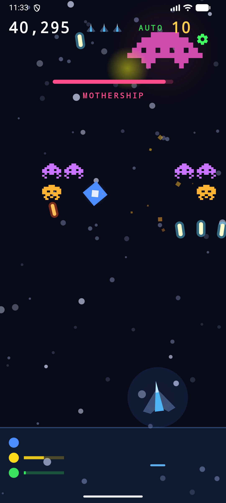
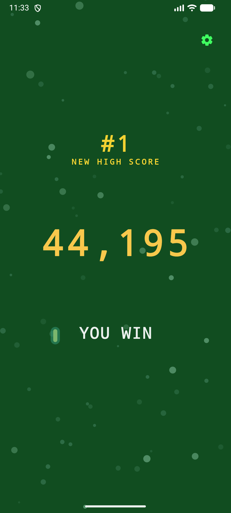
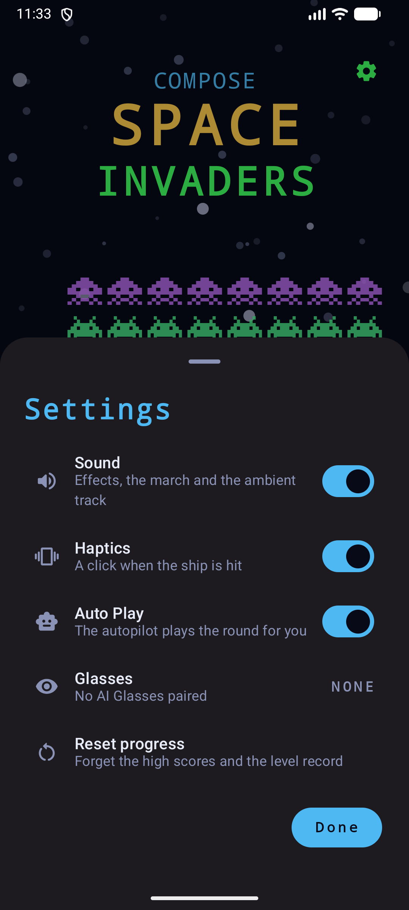

# Compose Space Invaders

[](https://github.com/jpcottin/ComposeSpaceInvaders/actions/workflows/ci.yml)

A **Space Invaders-like** game written entirely in **Kotlin** and **Jetpack
Compose**, adaptive from a phone to a foldable, a tablet, Android XR and a TV
with a D-pad — and playable on Display AI Glasses when a pair is connected.

The game is drawn on a Compose `Canvas`; everything around it (the HUD, the
title, the settings sheet, the end screens) is Material 3. The game itself is
a pure-Kotlin module with no Android in it, so its tests and the Auto Play
bench run on any JVM in seconds. Sibling of
[VulkanSpaceInvaders](https://github.com/jpcottin/VulkanSpaceInvaders), the
same game with a hand-written Vulkan renderer, and of
[ComposeBreakout](https://github.com/jpcottin/ComposeBreakout), built the
same way.

> **Status:** complete — ten levels, the mothership, the three bonuses, the
> saucer, the high-score table, the end screens, sounds and haptics, Auto
> Play, and it plays on a phone, a foldable (open, closed or half-opened), a
> tablet, an XR panel, a TV with a D-pad and a pair of AI Glasses.

## Screenshots

Captured on an Android phone emulator with Auto Play driving.

| Title, after a won campaign | Level 1 in play | The mothership |
|---|---|---|
|  |  |  |

| You win, a new high score | Settings |
|---|---|
|  |  |

## The game

- **Goal:** destroy every invader in the wave before it reaches your line.
- **Controls:** hold the strip below the ship: it steers toward your finger
  and fires while pressed. On a TV or a keyboard, left and right steer, OK,
  Enter or Space fire. The gear opens Settings from any screen; a tap on the
  title starts a round, a tap on an end screen returns to the title.
- **Progression:** ten levels. Level 1 fields 3 rows of 8 invaders; a row is
  added every other level (capped at 5 rows of 8). Each level marches faster,
  bombs more often and starts lower.
- **Marching:** the wave sweeps side to side, drops down at each edge, and,
  as in the 1978 original, speeds up as it thins; the last survivor is 3.5
  times faster than a full wave. The four-note march bass follows it.
- **Row tiers:** squid (top) 30 pts, crab (middle) 20 pts, octopus (bottom)
  10 pts, all times the level. Classic two-frame sprite animation synced to
  the march beat.
- **Bombs:** the bottom-most invader of a random column fires; bombs wobble
  as they fall and can be shot down in mid-air. Concurrent bombs and bomb
  speed scale with the level.
- **Mystery saucer:** crosses the top of the screen with a warbling siren,
  100 pts times the level, with the bonus value flashed where it died.
- **Bonuses:** one kill in twelve drops one: shield (absorbs one hit, lasts
  until hit), rapid fire (halved cooldown, 8 s with a timer bar), triple shot
  (a three-laser volley, centre plus ±8°, 8 s). +25 pts times the level on
  pickup.
- **Lives:** 3. Lose one to a bomb or an invader collision (the invader is
  destroyed too); the ship blinks invulnerable after each hit.
- **Invasion:** if the wave reaches the control strip, the invasion succeeds:
  instant game over, whatever the lives left.
- **Mothership at level 10:** a giant 16-hit saucer drifts across the top
  with a health bar, lobbing bombs aimed at you, guarded by a two-row escort.
  Only her death wins the game (+250 pts times the level).
- **Level pick:** the title screen offers any level reached before, with
  arrows to tap or left and right on a D-pad. A Reset progress row in
  Settings forgets the record along with the high scores.
- **Pause:** a round freezes when the screen goes away, when Settings opens,
  on Back, and on P, Escape or a remote's play/pause button. A tap, OK or the
  same key resumes; the autopilot resumes itself.
- **High scores:** a table of five, persisted; gold, silver and bronze on the
  title, the rank on the end screen when a record falls.
- **Sound:** every effect synthesised in real time: the laser sweep, the
  explosions, the hit, the level-clear arpeggio, the pickup sparkle, the
  saucer siren, the four-note march bass and an ambient A-minor bed. No
  audio files.
- **Haptics:** a light tick for a bonus picked up, a click when the ship
  is hit, with a switch in Settings.
- **Auto Play:** the autopilot dodges incoming bombs (the mothership's angled
  ones too, by predicted impact point), collects a bonus just before it
  lands, lead-aims the mothership, the saucer and the marching columns, and
  fires at whatever is lined up. It picks its column like a seasoned player:
  when the wave would reach the ship before it can be cleared, it clears the
  edge columns first (a narrower wave crosses more screen per step down) and
  switches to the bottom row when that row is about to land. It counts its
  lasers, so a column with a laser already on its way is left for the next
  one. It drives the exact same control path as a finger. Settings turns it
  on; the gear turns green and the HUD shows AUTO while it plays. Every
  change to it is measured with the [Auto Play bench](#the-auto-play-bench).
- **Play on AI Glasses:** with Display Glasses paired, the Glasses row in
  Settings hands the whole game to the glasses' projected display, where the
  touchbar drives it: finger position steers, contact fires. The phone shows
  an "on glasses" banner and waits; the same row brings the game home.

## Modules

| Module | What it is |
|---|---|
| `:engine` | The game: the wave, the ship, the bombs, the saucer, the mothership, the bonuses, the scoring, the autopilot and the synth. Pure Kotlin/JVM, no Android. Its tests and the Auto Play bench run on the host. |
| `:app` | The Compose shell: the canvas that draws the engine, the Material 3 chrome, settings and high scores in DataStore, the audio output, the glasses session. |

## Tech

- **Engine first.** `Game` is a plain mutable object the app steps once per
  frame with the real elapsed time; inside, the simulation runs in fixed
  ticks of 1/120 s, so a 60, 90 or 120 Hz display plays the very same game
  and the bench numbers are the same on every machine. The app reads its
  state to draw and feeds it input in world coordinates (x in
  [-aspect, aspect], y in [-1, 1]); it never sees pixels. Sounds, haptics
  and persistence go through a `GameHost` interface the ViewModel
  implements and the tests and the bench leave empty.
- **One frame counter.** The engine is not Compose state. A `LongState`
  counter is bumped once per step, and everything that shows engine state
  reads it: the canvas redraws without recomposing, and the overlays
  recompose once per step. The canvas places shapes and the overlays place
  text with the same world-to-pixel mapping, so they line up on every
  screen whatever the insets.
- **Sprites as paths.** The three invaders and the saucer are the classic
  pixel-art bitmaps, kept as `Path`s in cell units and scaled at draw time:
  one draw call per invader at any size. The ship is a delta-wing fighter
  that banks into its travel; lasers and bombs are two-layer bolts;
  explosions are expanding rings over spinning debris; the starfield
  scrolls in two parallax layers.
- **Adaptive.** The wave marches the full width of whatever screen it is
  on. A foldable half-opened (tabletop posture, read through Compose's
  MediaQuery API) puts the battlefield above the hinge and a control
  surface below it. A TV gets overscan-safe margins, larger text, and the
  D-pad: left and right steer, OK fires, Up reaches the gear, and the
  focus ring (Compose Styles API) shows where the cursor is. A wide window
  gets Settings as a centred dialog; a phone gets a bottom sheet. A short
  window (the glasses, a phone on its side) gets smaller text.
- **Keys everywhere.** A keyboard or a D-pad steers with the arrows or A
  and D, fires with OK, Enter, Space or the gamepad's A, pauses with P,
  Escape or play/pause, and picks the level on the title with left and
  right.
- **AI Glasses (Android XR projected).** `GlassesSession` observes pairing
  through `androidx.xr.projected` and launches `GlassesActivity` onto the
  projected display, where a second engine runs in touchbar mode with a
  pure black background (transparent on additive lenses) and no gear. The
  phone's engine freezes under a banner meanwhile, and the two share the
  high-score store.
- **Synth in the engine.** Every sound is generated by `Synth`, pure Kotlin
  and tested on the JVM (each effect sounds and ends, the march plays its
  note, the siren fades in and out, nothing clips when it all stacks). The
  app feeds it to a low-latency float `AudioTrack` from its own thread.
- **Persistence.** Settings, high scores and the level record live in
  DataStore; a round in progress survives process death through the saved
  state (level, score and lives come back with a fresh wave).
- **Accessibility.** A polite live region announces the round's events; the
  battlefield's state description says level, invaders left, lives and,
  on the last level, the hits the mothership has left; the
  HUD, the gear, the level pick and the end screen carry descriptions.
- **Languages.** English, French and Spanish, with a generated locale
  config so the app appears in the system's per-app language picker.
- `minSdk 26`, `targetSdk 37`, Jetpack Compose with the Compose BOM, Kotlin
  2.4, AGP 9.

## The Auto Play bench

`./gradlew :engine:run` plays seeded, headless rounds with the autopilot and
reports, per level and per campaign, how often it clears the wave, how it
dies (bomb, collision, invasion), how long a clear takes, lasers per kill
and lasers lost off-screen:

```bash
./gradlew :engine:run --args="--runs 100 --levels --campaigns"              # portrait phone
./gradlew :engine:run --args="--width 2400 --height 1080 --campaigns"       # landscape
./gradlew :engine:run --args="--runs 100 --levels --trace"                  # dump every lost life
./gradlew :engine:run --args="--seed 25 --level 9 --levels --trace"         # replay one run
```

Runs are seeded, so two builds of the same code give the same numbers and a
change to the autopilot is a before/after comparison. CI plays 100 portrait
and 50 landscape campaigns and fails when fewer than 95% are won. The
current autopilot wins 100% of campaigns on both, in 98 s on a portrait
phone and 132 s on a landscape screen on average.

## Build & run

```bash
./gradlew assembleDebug
adb install -r app/build/outputs/apk/debug/app-debug.apk
adb shell am start -n com.jpcottin.composespaceinvaders/.MainActivity

# An unattended round: Auto Play on, the round started
adb shell am start -n com.jpcottin.composespaceinvaders/.MainActivity --ez autoplay true
```

## Testing

```bash
./gradlew :engine:test                        # the game and the synth, on the JVM
./gradlew :app:testDebugUnitTest              # the app's unit tests
./gradlew :app:validateDebugScreenshotTest    # every screen against its reference image
./gradlew lintDebug
ANDROID_SERIAL=emulator-5554 ./gradlew :app:connectedDebugAndroidTest   # on one device
```

The engine tests cover the formation (rows per level, the march, edge
reversal and descent, the speed-up as the wave thins, the side margins),
the invasion (even through a shield), collisions, the ship (strip, drag,
keys, clamping, the lean), firing (strip, key, cooldown, the three-laser
cap, despawn), kills and per-tier scoring (at a clamped worst-case frame
too), bombs (cadence, cap, hits, invulnerability, shoot-down, the death
frame), the saucer, the bonuses, progression (the clear bonus, level 9 into
10, the end screens, the title return), the mothership (drift, aimed bombs,
the escort rule, the win), session restore, high scores, pause, the level
pick, settings, the glasses touchbar, and the autopilot (firing, dodging,
collecting, laser accounting, lead-aiming, the escort first, a wave cleared,
a campaign won). The screenshot tests render the title, a round in play, the
mothership, pause, level clear, game over and win on a phone, a foldable
(open and half-opened), a tablet, a TV and the glasses, plus the ten waves
and the settings screens. The instrumented tests launch the real activity
and drive it by tap, D-pad and keyboard, pause it from every path, pick a
level, reset the progress and listen as a screen reader.

## CI/CD

GitHub Actions runs on every push and pull request to `main`: the host
jobs (engine tests, lint, unit tests, screenshots, the APKs, the bench), the
instrumented tests on emulators (phones at API 33 to 36, a foldable, a TV,
with non-blocking legs on an XR headset, a swiftshader comparison and the
API 37.0, 37.1 and 37.2 images from the stable and canary emulators), and
the emulator experiments (the Android CLI, the Emulator Preview package, and
the multi-run snapshot cycles that launch an unattended round and check it
survives a restore). Changes are listed in the [changelog](CHANGELOG.md).

## License

[Apache License 2.0](LICENSE).
